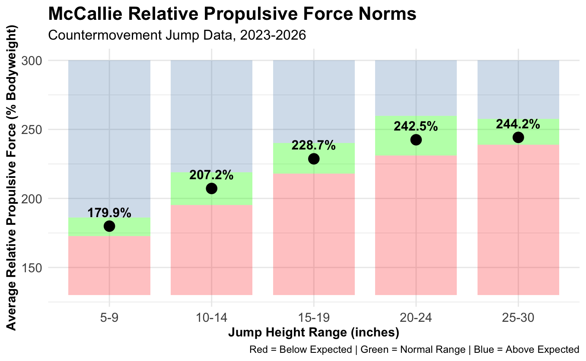
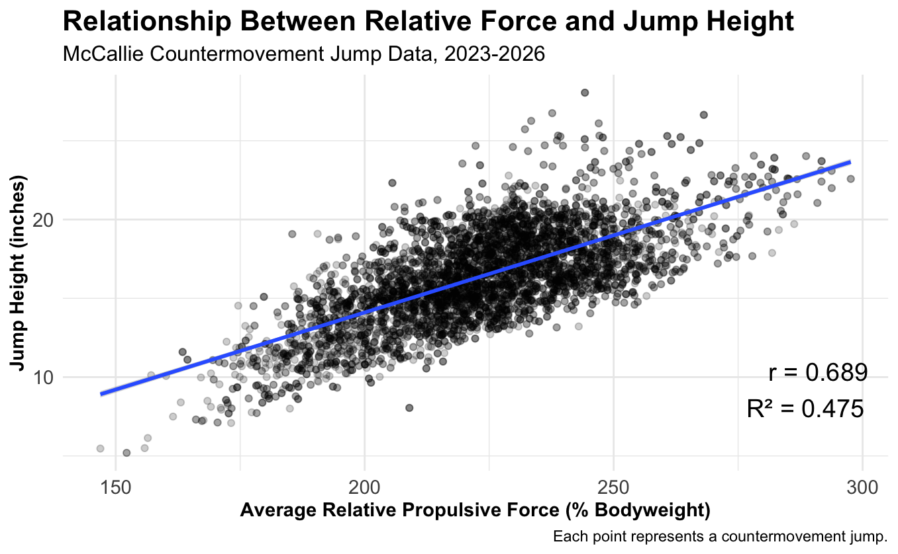

# Jump Performance & Force Analysis: McCallie School Strength & Conditioning

Strength coaches collect thousands of force-plate jumps, but raw numbers don't tell them whether an athlete's force output is *normal* for how high they jump. For this project I analyzed **7,200+ countermovement jumps (2023–2026)** from McCallie School's strength & conditioning program. I built normative force benchmarks that coaches can use to evaluate athletes and guide training.

**Tools:** R · tidyverse · readxl · knitr / kableExtra · ggplot2 · Quarto
**Methods:** Descriptive statistics · percentile-based norms · correlation · linear regression · data visualization

📊 **[Read the full write-up on my portfolio →](https://ben-bevill05.github.io/benbevill.github.io/mccallie.html)**

---

## Question

How does relative propulsive force (force as a % of bodyweight) relate to jump height, and what counts as a "normal" force range for athletes at a given jump height?

## Key Findings

| Metric | Result |
|---|---|
| Correlation between relative force and jump height (r) | **0.689** |
| Variance in jump height explained by relative force (R²) | **0.475** |

- **Relative propulsive force has a strong positive relationship with jump height.** It explains almost half the variation in how high athletes jump.
- **Normative ranges.** For each jump-height band (5–9, 10–14, 15–19, 20–24 and 25–30 inches), I defined a normal range using the 25th to 75th percentiles of relative force. This gives coaches a concrete benchmark for each athlete.
- **Color-coded chart.** A red / green / blue chart flags athletes producing **below-expected, normal, or above-expected** force for their jump height. It's designed to be read at a glance by coaching staff.

## Visuals

<p align="center">
  
  
</p>

## Approach

1. **Cleaned the data.** I kept jump height, average relative propulsive force and countermovement depth, and dropped incomplete records.
2. **Grouped the jumps.** I binned jumps into the coach's jump-height ranges.
3. **Built the norms.** For each range I calculated the count, mean, median, 25th and 75th percentiles, and standard deviation.
4. **Visualized the benchmarks.** I made a color-coded chart of below-expected, normal and above-expected force, with the median marked for each band.
5. **Quantified the relationship.** I computed the Pearson correlation and fit a linear regression of jump height on relative propulsive force.

## Data Note

The underlying force-plate data contains individual athlete records and is **not included** in this repository to protect athlete privacy. The analysis code is provided in full, and the figures above were generated from it.

## Repository Structure

```
├── analysis/
│   └── jump_force_report.qmd   # Full analysis (Quarto)
├── data/
│   └── README.md               # Expected data format (data not public)
├── images/                     # Figures used above
└── README.md
```

---

**Ben Bevill** · Data Analytics, Denison University · [Portfolio](https://ben-bevill05.github.io/benbevill.github.io/) · [LinkedIn](https://www.linkedin.com/in/ben-bevill-5a9190331/)
